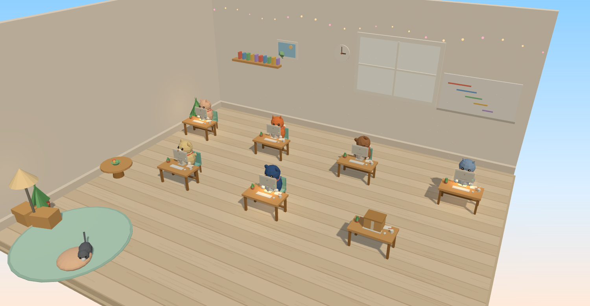

<div align="center">
  
  <h1>warren</h1>
  <p><b>A room full of coding agents.</b><br>
  Every agent CLI on your machine gets a desk — so you can see which one is working,<br>
  which has gone quiet, in which repository, and for how long.</p>
  <p>
    
    
    
  </p>
</div>

---

## What this is

A machine running coding agents unattended is only useful if you can tell what
they are doing. `warren` answers that twice — once as a table, once as a room you
actually want to open.

| | |
|---|---|
| 🏠 **a room** | a low-poly three.js diorama: one desk per session, the agent an animal at it |
| 📋 **a table** | `./dev.sh agents`, readable on a terminal or a phone |
| 🧾 **a document** | one JSON file, for whatever dashboard you already have |
| 🔔 **an alert** | a push when a session has been quiet too long |
| 📜 **a log** | every session's terminal output, kept after the pane is gone |

Nothing here asks the agents to cooperate. Everything is read from the outside:
`tmux`, `/proc`, `git`, and the pane logs the shell already writes. Add any CLI
you like — there is no plugin, no wrapper, no per-agent integration.

## The room

One desk per session. The animal is the CLI that is running, and **what it is
doing is visible in the scene** — no need to read anything:

| status | what you see | what it means |
|---|---|---|
| **working** | typing jiggle, paws on the keyboard, glowing scrolling screen | CPU time advanced between two samples, or output in the last 2 minutes |
| **waiting** | a slow sway, screen idle | an agent is live but nothing has happened for a while |
| **asleep** | eyes shut, head tilted, rounded **z** chips drifting up | no sign of life for 15 minutes — usually a permission prompt |
| **at the desk** | a plain idle animal | a session with no agent running in it |
| **packed up** | no animal, a sealed cardboard box | the session has ended; kept for a day with its log |

Every nameplate carries the session name and the answer to *how long* —
`working 12m`, `idle 4m`, `asleep 31m`, `packed up`. Clicking a desk opens a card
with the directory, the repository and branch, the changed files, the log path,
the last lines of output, and the `tmux attach` command.

Species by CLI: Claude Code a cream cat, Codex a fox, omp an otter, OpenCode an
owl, command-code a raccoon, Antigravity a penguin, Freebuff a squirrel,
everything else a hamster. Drag to turn the room, scroll to zoom.

## How it decides

Three independent signals, because any one of them lies on its own:

1. **`tmux`** — the session, its panes, and the window's activity time.
2. **`/proc`** — the foreground binary, the process tree, its CPU time and start
   time. **CPU time advancing between two samples is what separates "thinking"
   from "blocked on a prompt"** — from the outside those two look identical.
3. **the pane log** — written by `tmux pipe-pane`, so "what did it do" outlives
   the pane.

Detecting *which* agent is a little more subtle than it looks: several CLIs are
npm or bun packages, so the kernel's `comm` reads `node` or `bun` and only the
argument names the agent. `warren` checks both the process name and every
argument's basename, which is why `cmd`, `omp` and `freebuff` are recognised.

## Install

Requires a Linux host with `tmux`, `python3`, and a user you can dedicate to
coding. `systemd` is optional (for the collector timer and the alerts).

```sh
git clone https://github.com/omerdikyol/warren && cd warren
scp -r . host:/tmp/warren
ssh host 'sudo /tmp/warren/provision.sh --dry-run'   # show what would change
ssh host 'sudo /tmp/warren/provision.sh'             # apply
```

`provision.sh` is idempotent. It creates the dev user, installs the baseline and
the toolchains, lays out the workspace, deploys the shell config, and enables the
timers. Then deploy the host side:

```sh
ssh host 'sudo install -m 755 /tmp/warren/dev-agents.py /tmp/warren/host/*.sh /usr/local/bin/'
ssh host 'sudo install -m 644 /tmp/warren/host/*.service /tmp/warren/host/*.timer /etc/systemd/system/ \
          && sudo systemctl daemon-reload \
          && sudo systemctl enable --now dev-agents.timer dev-agents-guard.timer'
```

Give it somewhere to put sessions and repos, and set `DEV_ROOT`/`USERDEV` at the
top of `dev.sh` and `provision.sh` to match.

## Use

```sh
./dev.sh session fix-auth ~/coding/jobtrack   # a desk appears
./dev.sh agents                               # the table, from anywhere
./dev.sh agents --json                        # the same document
./dev.sh attach fix-auth                      # or: tmux attach -t fix-auth
./dev.sh kill fix-auth                        # the desk is packed up
```

Run a session's work through the IO guard when the machine's disk is slow:

```sh
./dev.sh build ~/coding/jobtrack uv run pytest -q
```

`dev-build.sh` refuses to run when the workspace is unavailable, takes a lock so
only one heavy job runs at a time, and drops to low CPU and IO priority, so a
build cannot stall the rest of the machine.

## The JSON contract

The collector writes one document, which is everything the room and the table
draw. Point any dashboard at it — `/run/tezb-dashboard/dev-agents.json` by
default, `--out` to change it.

```jsonc
{
  "generated": 1792623542,
  "stale_after_seconds": 900,
  "live": [
    {
      "name": "fix-auth",              // tmux session
      "agent": "claude",               // the CLI detected, or null
      "status": "working",             // working | waiting | stale | shell
      "repo": "jobtrack",              // from git, null outside a repository
      "branch": "fix-auth",
      "changed_files": 3,
      "dir": "/srv/dev/coding/jobtrack",
      "runtime_seconds": 742,
      "idle_seconds": 3,               // silence since the last sign of life
      "log": "/home/dev/.local/state/dev/logs/fix-auth.log",
      "last_lines": ["pytest -q", "..... 47 passed in 3.2s"]
    }
  ],
  "ended": [ { "name": "old-task", "status": "ended", "ended_at": 1792618000 } ]
}
```

## Repository layout

```
provision.sh          idempotent setup: user, toolchains, workspace, dotfiles
dev.sh                the front door: session, agents, repos, build, cache
dev-build.sh          one heavy job at a time, at low IO priority
dev-agents.py         the collector (tmux + /proc + git + pane logs)
repos.tsv             the repositories to keep on the box
env.example           every variable the box expects, no values
dotfiles/             zshrc, tmux.conf, gitconfig, mise.toml
host/                 systemd units: the collector, the stale guard, cache GC, space guard
room/                 the three.js room (room3d.js, room.css, room.html)
room/vendor/          three.js r169, vendored — no CDN at runtime
docs/room.png         the picture above
```

The room is deployed to a dashboard by copying `room/` into its static
directory; `room.html?mock=1` previews every state without a box behind it, and
`?shot=1` hands the rendered frame out as a data URL (a headless browser cannot
screenshot a WebGL canvas directly — the back buffer is discarded first).

It has no build step and no runtime dependency beyond the vendored three.js,
which is generated geometry only: no models, no textures on disk.

## Notes

- Sessions live in `tmux`, so they survive a dropped connection but **not a
  reboot**.
- An ended session is kept for a day so its log outlives its pane.
- Permission prompts are the usual reason a session goes quiet; the guard alerts
  so an agent waiting at 2am does not sit there silently.
- Developed against the `tezb` home server, whose repo holds the deployed copy
  and the machine-specific notes.

## Credits

- [three.js](https://threejs.org) r169, MIT — vendored under `room/vendor/`.
- The room, the animals and the collector were written for this project.

MIT — see [LICENSE](LICENSE).
